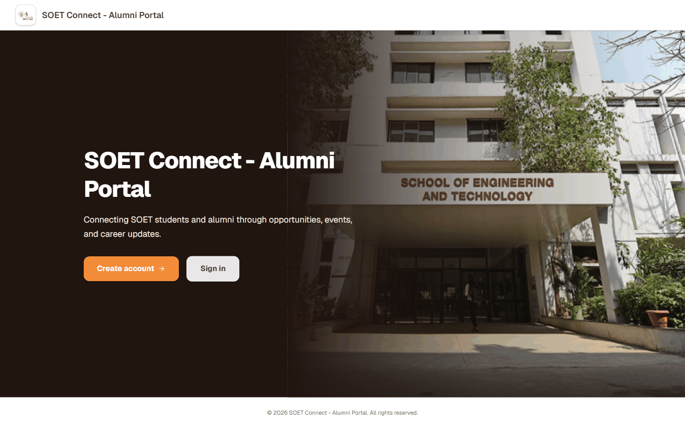
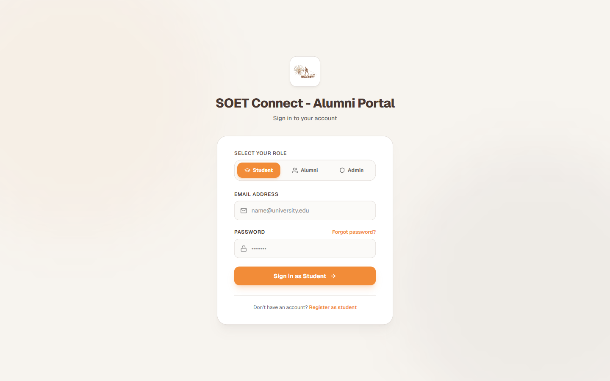

# SOET Connect

[](https://github.com/rohan26-bit/SOET-Connect/actions/workflows/ci.yml)
SOET Connect is an alumni engagement portal for the School of Engineering and Technology. It brings students, alumni, and administrators together through a shared platform for alumni profiles, career opportunities, events, announcements, and communication.

This is an academic team project developed as part of the B.Tech Computer Science and Engineering programme at MGM University.

## Project overview

The application is organised around role-specific experiences for students, alumni, and administrators. Its frontend communicates with a Python API, while application data is persisted through Supabase PostgreSQL.

## Core modules

The current codebase includes modules for:

- **Authentication and profiles** — registration, login, and user profile workflows.
- **Alumni directory** — alumni profile discovery and related profile operations.
- **Career opportunities** — job listings and application workflows.
- **Events** — event management and registration.
- **Announcements and notifications** — institution updates and user notifications.
- **Messaging** — conversation and message functionality.
- **Gallery** — media and gallery management.
- **Administration** — administrative operations and management endpoints.
- **Bug reports** — in-app issue reporting.

## Screenshots

### Landing Page

*The landing page displaying MGM University branding, campus imagery, and portal navigation.*

### Authentication & Role Selection

*Role-based sign-in interface supporting student, alumni, and administrator access.*

## Technology stack

| Layer | Technologies |
|---|---|
| Main web application | Next.js, React, TypeScript |
| UI styling and icons | Tailwind CSS, Lucide React |
| Backend API | Python, FastAPI |
| Database | Supabase PostgreSQL |
| Authentication and security | JWT, Argon2 password hashing |
| API documentation | FastAPI / OpenAPI |
| Testing | Pytest |
| Version control | Git, GitHub |

The repository also contains a separate Vite-based React workspace in `frontend/`. The Next.js application documented in the setup instructions below is located in `SoETAlumniPortal/`.

## Architecture

```text
Browser
  |
  v
Next.js / React application
  |
  |  /api/* requests
  v
FastAPI backend
  |
  v
Supabase PostgreSQL
```

The Next.js configuration forwards `/api/*` requests to the backend URL configured through `BACKEND_URL`.

## Repository structure

```text
SOET-Connect/
├── SoETAlumniPortal/   # Next.js web application
├── backend/            # FastAPI application, routes, services and tests
├── supabase/            # Database migrations
├── frontend/            # Separate Vite + React workspace
└── README.md
```

## Run locally

### Prerequisites

- Python 3.11 or a compatible supported Python version
- Node.js and npm
- A Supabase project with the required database schema

### 1. Configure and start the backend

From the repository root:

```bash
cd backend
python -m venv .venv
```

Activate the virtual environment.

**Windows PowerShell**
```powershell
.venv\Scripts\Activate.ps1
```

**macOS / Linux**
```bash
source .venv/bin/activate
```

Install dependencies:

```bash
pip install -r requirements.txt
```

Create a local environment file from the example:

**Windows PowerShell**
```powershell
Copy-Item .env.example .env
```

**macOS / Linux**
```bash
cp .env.example .env
```

Set the required values in `.env`, including:

- `SUPABASE_URL`
- `SUPABASE_SERVICE_ROLE_KEY`
- `SUPABASE_ANON_KEY`
- `JWT_SECRET_KEY`

Keep real credentials private. Do not commit your `.env` file.

Start the API:

```bash
uvicorn main:app --reload --port 8000
```

The API is available at `http://127.0.0.1:8000`. Interactive API documentation is available at `http://127.0.0.1:8000/docs`, and the health endpoint is `http://127.0.0.1:8000/health`.

### 2. Configure and start the Next.js application

Open a second terminal from the repository root:

```bash
cd SoETAlumniPortal
npm install
```

Create `.env.local` in `SoETAlumniPortal/` and set the backend origin:

```env
BACKEND_URL=http://127.0.0.1:8000
```

Start the development server:

```bash
npm run dev
```

Open `http://localhost:3000`.

For a deployed environment, set `BACKEND_URL` to the deployed API origin in the frontend hosting environment.

## Tests

Backend tests are located in `backend/tests/`. From the backend directory, run:

```bash
pytest
```

Use the test configuration and environment settings appropriate for your local test run.

## Security notes

- Never commit `.env`, service-role keys, JWT secrets, or other credentials.
- Keep the Supabase service-role key on the server only; never expose it to browser-side code.
- Use strong, unique secrets for local and deployed environments.

## Project scope

SOET Connect is an academic project. To run it locally, configure the backend environment, Supabase project, and frontend backend URL as described above. External integrations may require their own credentials and configuration.
